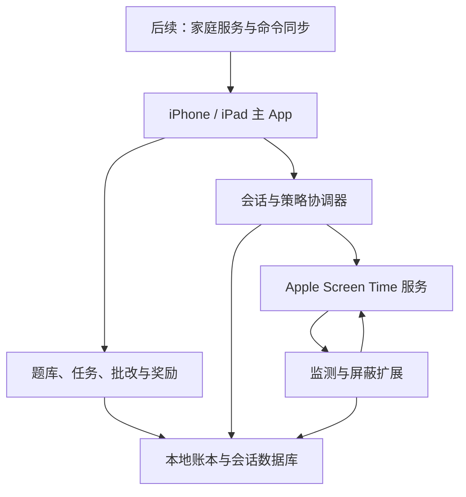
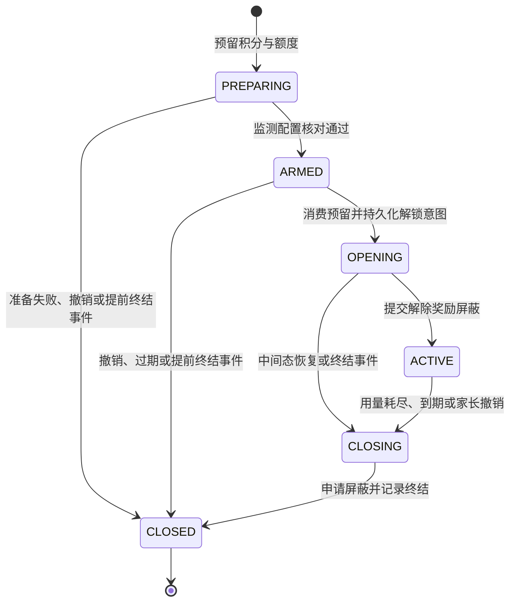
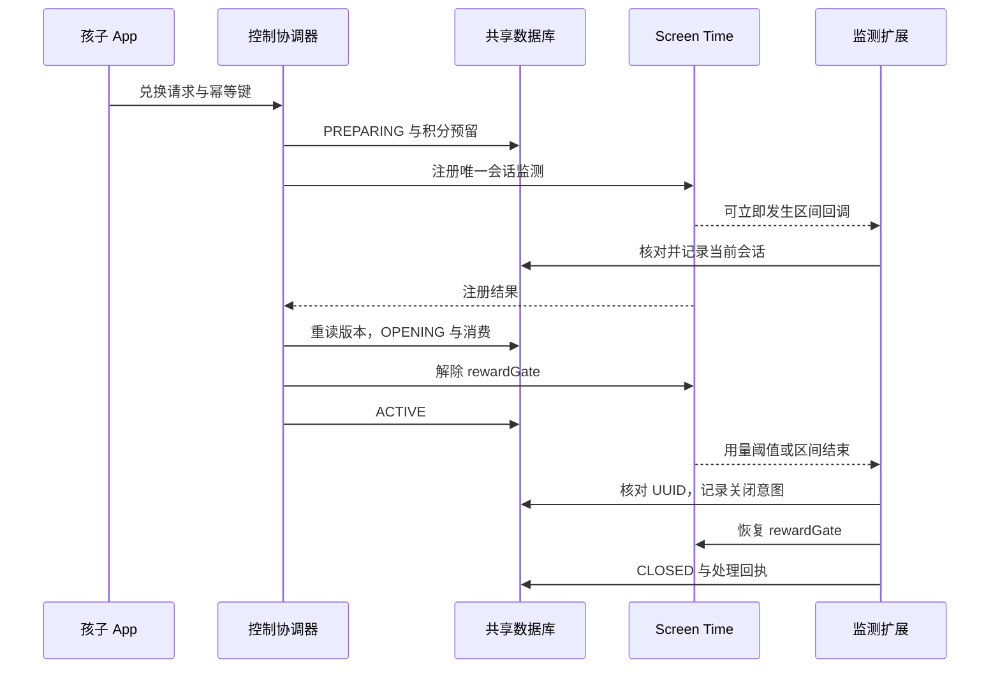

# iPhone 和 iPad 学习奖励管控技术方案

版本：v1.0 · 设计日期：2026-11-06 · 状态：可用于原型开发与任务拆分，尚未进行 iOS 真机实现验证。

目标：孩子在 iPhone 或 iPad 上完成学习任务，获得积分，再兑换所选娱乐 App 的使用额度；家长决定题目、奖励规则、可用时段和允许的应用。按 iPhone + iPad（iOS / iPadOS）统一设计。

# 1. 推荐方案与实施范围

采用 **Swift + SwiftUI 原生通用 App，配合 FamilyControls、ManagedSettings、DeviceActivity 和三个系统扩展**。学习与奖励由本地业务引擎负责，娱乐使用量和屏蔽交给 Apple Screen Time API。先完成单设备离线闭环，再增加家长远程管理。

首版默认最低系统为 **iOS / iPadOS 18**。这是减少兼容分支的工程选择；本方案所依赖的 `includesPastActivity` 参数从 17.4 起可用，18 不是 Apple API 的最低要求。iOS / iPadOS 26.5 及以后可增强屏蔽页跳转和 Token 更新，但不作为首版基本功能的前提。[Apple 事件初始化文档](https://developer.apple.com/documentation/deviceactivity/deviceactivityevent/init(applications:categories:webdomains:threshold:includespastactivity:))

| 关键问题 | 本方案的默认决策 | 原因与影响 |
|---|---|---|
| 客户端技术 | SwiftUI + 独立领域模块 + 原生扩展 | iPhone / iPad 共用核心代码，系统管控不经过跨平台桥接 |
| 第一版使用方式 | 每台孩子设备一个本地档案；同设备家长入口 | 不依赖账户、服务器、推送即可完成学习和兑换 |
| 额度模型 | 积分兑换固定单次会话，如 5 分钟或 10 分钟用量、最长 30 分钟内有效 | 用量额度与自然时间有效期分开，避免精确余额恢复的错误承诺 |
| 钱包范围 | 每台孩子设备独立钱包 | 两台离线设备不能重复花同一份积分 |
| 当前会话 | 每设备最多一个；不在进行中追加、暂停或重建 | 避免重置系统用量统计、错序回调和重复开放 |
| 计费规则 | 创建时预留积分；准备解锁时转为消费；之后不自动退未用分钟 | 已进入解锁阶段时，系统未提供可供本模型精确结算的逐秒消费回执 |
| 家长身份 | Apple 儿童授权 + 产品家长口令 / 家长账户 | Apple 家庭授权与应用内家长权限分别管理 |
| 数据与扩展 | SQLite 事务、App Group、共享控制锁 | 主 App 与扩展跨进程运行，不能仅靠 actor 或 UserDefaults 保证一致性 |
| 远程管理 | 第二阶段引入 HTTPS 后端、APNs、命令回执 | 推送只提示同步，孩子设备负责最终执行 |
| AI 批改 | 后续可选；不拥有奖励或解除限制权限 | 学习核心离线可用，奖励结果可审计 |

## 1.1 阶段范围

| 阶段 | 交付能力 | 进入下一阶段的条件 |
|---|---|---|
| P0 平台验证 | 儿童授权、应用选择、屏蔽、兑换、达到用量后屏蔽、有效期结束后屏蔽 | 目标 iPhone 和 iPad 真机跑通；明确观察到的系统延迟和失败情形 |
| P1 本地 MVP | 题库导入、客观题、任务、积分账本、固定会话、家长设置、允许时段、恢复和诊断 | 故障注入下不重复发奖、不双开会话、不因重启业务进程赠送新额度 |
| P2 远程家庭管理 | 家长 iPhone / iPad 管理儿童设备、策略版本同步、人工批改、命令状态 | 离线和重试语义明确；设备回执与家长 UI 一致 |
| P3 学习增强 | 间隔复习、AI 辅助批改、手写、学习分析、家庭额度分配 | 前面阶段稳定，单独完成数据授权与对应验收 |

首版限制的是家长选中的娱乐 App / 分类，不能据此承诺锁住整台设备、阻止所有网页绕行或替代系统全部家长控制。浏览器域名、画中画、后台音频和 iPad 多任务行为分别列入验证与能力说明。

# 2. 如何参考 StudyOnTV

参考仓库为 [chadyi/StudyOnTV](https://github.com/chadyi/StudyOnTV)，本方案采用此前源码检查的固定快照 `bb75592e05bdcd4ed2b664cfab3a371ab38f2a57`。它提供学习任务、题库、奖励和家长管理思路；现有 Android 管控路径依赖前台应用判断、权限服务和覆盖层，iOS 版本需要重新实现系统集成。

| StudyOnTV 的参考点 | iOS 方案 |
|---|---|
| 题库、题型、JSON 导入 | 自建版本化题库模型；提供 v2 格式转换器 |
| 学习结果换奖励、连击或练习规则 | 纯业务 RuleEngine；奖励唯一性由账本约束保证 |
| 人工 / AI 批改 | 统一 GradeDecision；待确认结果不发可消费奖励 |
| 错题与复习 | 分离练习记录、掌握度和待复习日程；避免反复刷同一结果领分 |
| Android GuardService 与覆盖答题界面 | FamilyControls 授权、ManagedSettings 屏蔽、DeviceActivity 监测；答题在自己的 App 内完成 |
| 本机 Web 管理入口 | 首版原生家长入口；远程版本采用有身份验证的服务端接口 |

来源：[项目说明](https://github.com/chadyi/StudyOnTV/blob/bb75592e05bdcd4ed2b664cfab3a371ab38f2a57/README.md)、[题库与 AI 接口说明](https://github.com/chadyi/StudyOnTV/blob/bb75592e05bdcd4ed2b664cfab3a371ab38f2a57/docs/ai-api.md)。

**代码与素材采用独立实现。** 该快照的许可为个人家庭非商业用途的 Source Available 许可；向第三方分发、商业使用等需要原作者事先书面许可。公开发布前应明确授权，不能因为仓库可读就把它当成 MIT / Apache 开源项目直接移植。本文参考交互与业务概念，不以复制其源码、题目素材或品牌为实施前提。[仓库 LICENSE](https://github.com/chadyi/StudyOnTV/blob/bb75592e05bdcd4ed2b664cfab3a371ab38f2a57/LICENSE)

# 3. Apple 能力边界

## 3.1 各框架负责什么

| 框架 / 组件 | 职责 | 在本方案中的用途 |
|---|---|---|
| FamilyControls | 申请家长控制授权，提供隐私保护的应用选择 | `.child` 授权、FamilyActivityPicker、保存选择 Token |
| ManagedSettings | 对应用、分类、网站等施加设置与屏蔽 | 维护奖励屏蔽和家长策略两个命名 Store |
| DeviceActivity | 按时间区间监测选定对象，用量达到阈值时唤起扩展 | 一次性奖励会话、允许时段边界 |
| ManagedSettingsUI | 系统屏蔽界面的外观 | 提示先完成学习、显示简短操作说明 |
| ShieldAction 扩展 | 处理屏蔽页按钮 | 提供受系统支持的返回学习入口行为 |
| DeviceActivityReport | 按系统隐私机制呈现使用报告 | 后续报表能力，不作为账本扣款或实时剩余秒数的依据 |

这些框架是 Apple 官方家长控制方案的组成部分。[Screen Time API 概览](https://developer.apple.com/documentation/ScreenTimeAPIDocumentation)、[FamilyControls](https://developer.apple.com/documentation/familycontrols)、[DeviceActivity](https://developer.apple.com/documentation/deviceactivity)。

## 3.2 必须体现在设计中的平台约束

| 已核实约束 | 工程处理 |
|---|---|
| 监测区间至少 15 分钟，最长一周 | 5 / 10 分钟是使用阈值；监测窗口默认 30 分钟，不能直接创建 5 分钟窗口 |
| App 及其扩展合计最多同时监测 20 个 activity | MVP 常驻一个允许时段 activity，加一个活跃会话；不按题目或每个 App 各开一个 |
| 同名 `startMonitoring` 会覆盖既有 schedule 和 events | 会话使用唯一 UUID；主 App 再次启动时核对原监测，不重新注册来“恢复” |
| 正在进行的 interval 注册后可能立刻触发回调 | 先持久化 PREPARING，再调用注册；回调不能依赖注册函数已经返回 |
| event 的应用、分类、网站三组都为空时，含义是包含所有对象 | 首版明确拒绝空选择，不能把它当成“未选择所以不监测” |
| schedule 的起止是回调最早可能发生的时间；实际执行与设备使用有关 | 不把有效期或边界回调宣传成精确后台闹钟 |
| 停止进行中的监测也可能产生 `intervalDidEnd` | 回调幂等，并区分旧会话与当前会话 |

来源：[最短区间](https://developer.apple.com/documentation/deviceactivity/deviceactivitycenter/monitoringerror/intervaltooshort)、[最长区间](https://developer.apple.com/documentation/deviceactivity/deviceactivitycenter/monitoringerror/intervaltoolong)、[activity 数量](https://developer.apple.com/documentation/deviceactivity/deviceactivitycenter/monitoringerror/excessiveactivities)、[注册行为](https://developer.apple.com/documentation/deviceactivity/deviceactivitycenter/startmonitoring(_:during:events:))、[事件选择语义](https://developer.apple.com/documentation/deviceactivity/deviceactivityevent/init(applications:categories:webdomains:threshold:includespastactivity:))、[nextInterval](https://developer.apple.com/documentation/deviceactivity/deviceactivityschedule/nextinterval)。

## 3.3 承诺的边界

我们可以保证自己的业务协议在状态不明时不主动开放，在获得执行机会并发现到期、耗尽、撤销或配置异常时申请恢复屏蔽。**如果已经开放，之后系统一直没有调用扩展，而主 App 也没有执行机会，普通 App 无法凭空执行重新屏蔽。** Timer、后台刷新和 APNs 都不能构成独立的实时兜底。

因此，“默认屏蔽、注册成功后才开放、观察到故障时保守恢复”是设计目标；“任何系统异常下绝不会超过 10 分钟”不是本方案可以提供的保证。正式版本必须用真机数据说明回调延迟、提前触发、漏触发和恢复行为。[Apple 区间结束语义](https://developer.apple.com/documentation/deviceactivity/deviceactivitymonitor/intervaldidend(for:))、[后台推送限制](https://developer.apple.com/documentation/usernotifications/pushing-background-updates-to-your-app)。

# 4. 系统架构



图中双向控制不是后台常驻轮询：主 App 注册监测、提交屏蔽设置；系统在获准的时机调用扩展，扩展读取本地状态并处理。

## 4.1 Target 与模块

| Target / 模块 | 职责 | 不应承担的工作 |
|---|---|---|
| Main App | SwiftUI、题库、答题、家长配置、兑换、授权、同步 | 不用主进程秒表裁决真实娱乐用量 |
| DeviceActivityMonitor Extension | 启停区间、阈值回调、幂等关闭、轻量恢复 | 不做 AI、题库导入、复杂迁移和网络依赖的决策 |
| ShieldConfiguration Extension | 读取最小展示快照，生成屏蔽页面 | 不渲染完整答题 App，不展示答案或私密学习记录 |
| ShieldAction Extension | 屏蔽页按钮、允许的跳转行为 | 不在按钮中直接发奖或无条件解除限制 |
| LearningCore | Question、Attempt、GradeDecision、任务完成规则 | 不直接调用系统屏蔽 API |
| RewardCore | 积分账本、兑换成本、每日发放与兑换上限 | 不依赖 UI 的“已答对”布尔值 |
| ControlCore | 会话状态机、版本校验、控制锁、恢复协议 | 不把系统副作用视为数据库事务的一部分 |
| ScreenTimeAdapter | 包装系统 API，提供可替换的测试接口 | 不隐藏平台错误，不承诺系统调用即是可见效果确认 |
| SyncCore（P2） | 认证、命令收取、回执、上传最少摘要 | 不绕过本地授权直接改变儿童设备 |

DeviceActivityReport Extension 在需要报告时再添加。主 App 和需要使用 Screen Time 能力的扩展必须分别配置相应 entitlement；分发权限也按 Apple 要求申请。[分发 entitlement 文档](https://developer.apple.com/documentation/familycontrols/requesting-the-family-controls-entitlement)。

## 4.2 两个命名 Store

| Store | 屏蔽条件 | 解除条件 |
|---|---|---|
| `rewardGate` | 没有合法活动会话，或会话耗尽、过期、被撤销 | 仅当前会话完成注册与状态检查后解除 |
| `parentPolicy` | 已有有效选择时，家长暂停或允许时段以外 | 当前策略允许且管控状态可用；会话兑换不能清除此 Store |

两个 Store 共享同一份已选择对象快照，写入均经过 ControlCore。Store 不按每次会话无限新增。命名 Store 可在主 App 与扩展间共享，多项限制组合时采用更严格的设置，因此兑换只清理 `rewardGate`，不能顺便清空家长限制。[Apple WWDC22：命名 Store](https://developer.apple.com/videos/play/wwdc2022/110336/)

`rewardGate` 的解除只由主 App 的合法 OPENING 路径发起；Monitor 扩展负责关闭，不凭区间开始回调开放。`parentPolicy` 的解除必须重算当前时间、暂停状态和最新策略，不能直接执行旧时段的“开始”事件。无活动会话时先确保 `rewardGate` 已申请屏蔽，再按当前策略解除另一层。最初尚无有效选择对象时只能禁止兑换并等待设置完成，不能宣称已经屏蔽了未选定的 App。这些写权限是项目代码约定，不是 named store 自带的权限隔离。

“家长硬规则”表示业务优先级；时段切换依然受系统回调执行边界影响。其他系统 Screen Time 设置也可能继续限制应用，不能因为本 App 清除自己的设置就承诺目标 App 一定可打开。

# 5. 学习与奖励规则

## 5.1 学习结果与使用权分层

学习层产生可审计的完成记录；奖励层把合格记录转换成积分；兑换层把积分转换成当前设备的一次使用许可。答题界面、AI 返回值和屏蔽页按钮均不能直接打开娱乐 App。

示例默认规则可采用：家长指定一个 5 题任务，首次达到 80% 获得 10 积分；5 积分兑换 5 分钟、10 积分兑换 10 分钟；每日最多发放 30 积分，每日最多兑换 20 分钟。以上数值只是产品初始配置，可由家长修改，正在进行的任务与会话使用各自开始时的规则快照。

| 规则对象 | 设计 |
|---|---|
| 题目 | 稳定 question_id + revision；题型、题干、选项、答案、解释分开 |
| 任务 | task_instance_id，绑定儿童、设备、题目版本、规则版本和可领奖次数 |
| 作答 | 每次提交有 attempt_id；重复提交同一 id 返回相同结果 |
| 批改 | 客观题本地确定性判分；文本题规范化规则版本化；主观题先 pending |
| 发奖 | 一个 rewardable_completion_id 最多一条奖励来源记录；版本改变不能再次领奖 |
| 复习 | 可继续作答和记录掌握度；只有新的明确任务实例才能产生新奖励 |
| 负面结果 | 首版不扣既有积分；错误进入讲解或后续复习 |
| 家长补偿 | 独立 `MANUAL_GRANT`，有原因、操作者与幂等键，不修改历史消费 |

同一道题可以在不同合法任务中重复出现，但不能靠重放同一作答、重复批改、改规则版本或在两台设备重复提交同一个任务领取两次共享奖励。P1 任务及钱包按设备分开；跨设备任务唯一性到 P2 / P3 由服务端明确管理。

## 5.2 积分与每日上限

使用整数积分和整数秒，不使用浮点余额。账本至少有 `EARN`、`RESERVE`、`CONSUME`、`RELEASE`、`MANUAL_GRANT` 类型；每条账目不可变，修正通过新账目体现。积分首版不自动过期，兑换的会话有有效期。

每日上限限制“已分配的会话用量”，不是估算实际玩了多少秒。预留时占用当日额度，注册失败且未进入解锁阶段时一并释放；进入 OPENING 后计入已分配额度。这样可以精确约束兑换总额，但无法消除系统回调延迟带来的实际使用偏差。

日期归属由家长配置的家庭时区决定，默认取初始化时的时区；存储明确的 ledger_day 和 timezone_id。修改时区属于家长操作，不按设备临时显示日期重新发放当日奖励。

# 6. 固定单次娱乐会话

## 6.1 三个时间概念

| 名称 | 示例 | 含义 |
|---|---|---|
| 使用额度 `usage_budget_seconds` | 600 秒 | 系统对选中对象累计使用达到阈值后通知扩展 |
| 会话有效窗口 | 19:00—19:30 | 该许可最晚应结束的自然时间范围；离开娱乐 App 时有效期继续走 |
| 家长允许时段 | 18:00—20:00 | 业务允许兑换和娱乐的时间段，优先于会话许可 |

例如：19:00 兑换 10 分钟，使用 3 分钟后离开，19:15 回来继续，系统继续统计原会话；达到阈值或到 19:30 时结束。到期时未用部分不自动退还，也不会挪到第二天。界面提前说明这个规则，并允许家长对异常情况补发积分。

新奖励只进入钱包，不改变当前会话。首版不提供进行中的加时、暂停后精确续接和按剩余秒数退款。家长主动结束或更改所选应用时，先终结当前会话，再应用新策略。

## 6.2 监测参数

```text
activityName = session.<deviceID>.<sessionUUID>
eventName    = budget.<sessionUUID>
schedule     = [registeredAt, expiresAt]，repeats = false
event        = 选中应用 / 分类的组合
threshold    = 5 或 10 分钟
includesPastActivity = false
```

这是设计表示，不是可直接编译的 SDK 示例。实现应使用明确年月日、时区和边界日期组件，并检查系统计算出的 `nextInterval` 与预期一致。

默认 `expiresAt = min(registeredAt + 30 分钟, 允许时段结束, 家庭日结束)`。如果剩余有效窗口不足 15 分钟，首版拒绝新兑换，提示“当前可用时段即将结束，请在下个时段兑换”，不构造不合法的短监测区间。第一版只配置每天一个不跨午夜的允许时段；多时段及跨午夜留到后续。

常驻允许时段 activity 也必须满足最短区间要求。最终调用注册前，用实际日期组件重新计算并核验区间长度，不能只依赖兑换页较早的估算；检查失败走未开放会话的预留释放流程。

`includesPastActivity = false` 避免把本次注册以前的使用量计入新许可。不要为了恢复界面而重启 monitor，也不要通过改变同一 monitor 的阈值实现即时加时。[Apple 事件文档](https://developer.apple.com/documentation/deviceactivity/deviceactivityevent/init(applications:categories:webdomains:threshold:includespastactivity:))、[注册覆盖语义](https://developer.apple.com/documentation/deviceactivity/deviceactivitycenter/startmonitoring(_:during:events:))。

## 6.3 状态机



`CLOSED` 保存 reason：`exhausted`、`expired`、`revoked`、`setup_failed`、`uncertain`。终结状态不可恢复为 ACTIVE；新兑换必须创建新 UUID。实际屏蔽是否可见与系统回调是否及时，是独立于数据库状态的验证事项。

管控健康度另外建模为 `unconfigured / authorizing / configured / attention_required / authorization_revoked`。不能把 session 的 ACTIVE 状态当成“系统管控已保证有效”的证明。

# 7. 兑换、回调和并发协议

## 7.1 安全的兑换顺序

1. 确认授权、选择非空、家长时段、余额、每日上限和设备无其他非终结会话；保证 `rewardGate` 已申请屏蔽。

2. 在共享控制锁与 SQLite 短事务中创建 PREPARING，预留积分和当日额度，持久化选择快照、策略版本、授权 epoch、唯一 activity / event 名。

3. 释放锁，在锁外调用 `startMonitoring`。扩展此时可能立即得到回调。

4. 核对 `activities`、`schedule(for:)`、`events(for:)` 的配置与预期，读取扩展的启动回执作为健康信号。启动回执不能证明后续回调一定到达。

5. 再取控制锁、重新读取最新状态。若会话已经终结、授权 / 策略 / 选择版本变化或已过期，就清理并保持屏蔽。

6. 写入 ARMED，再通过事务持久化 OPENING 与外部副作用意图，把预留积分转成消费。

7. **最后解除 `rewardGate` 的对应设置**，保留 `parentPolicy`；随后记录 ACTIVE。

未进入 OPENING 的任何终结，包括注册失败、撤销、等待到期和提前回调，都在同一事务中终结会话并释放积分及每日额度预留。如果已经进入 OPENING，即使随后进程退出，也不能自动假定“从未开放”并退款。恢复时申请屏蔽、结束为 uncertain，家长可独立补偿。以是否已经提交 CONSUME 判断释放资格，不仅根据 close_reason；例如 expired 可以发生在开放前或开放后。



## 7.2 为什么需要跨进程协调

Swift actor 只隔离单进程里的访问；主 App 与扩展各有自己的进程。UserDefaults 适合展示偏好，不提供“余额充足、扣款、创建唯一会话”所需的多字段事务与唯一约束。

采用 App Group 内 SQLite WAL 数据库；所有写入遵循一致的锁顺序：先取得短时 POSIX 控制锁，再开启必要的数据库事务。控制锁覆盖“读取最新会话 → 核对 UUID / revision → 提交 ManagedSettings 修改”的短路径。不得在锁内等待网络、AI、用户输入或 `startMonitoring` 回调。[Apple 扩展共享容器指引](https://developer.apple.com/library/archive/documentation/General/Conceptual/ExtensibilityPG/ExtensionScenarios.html)

**ManagedSettings 写入不属于 SQLite 事务。** 数据库提交和系统可见效果之间存在间隙，通过预先持久化意图、版本检查和恢复流程收敛，不能宣称两者原子一致。关闭流程先持久化 CLOSING 意图，随即申请屏蔽，再标记 CLOSED；任一中间态恢复方向都是重新申请屏蔽。

锁获取与数据库 busy 重试必须有界。拿不到锁时不根据旧缓存解除屏蔽，不把回调标记为处理成功。记录诊断并在下一次有执行机会时 reconcile；如果当次关闭因锁或系统执行失败未完成，不能承诺立即收回使用权。锁等待和失败率是 P0 / P1 的重点真机指标。

如果某次阈值回调未能持久化，不能假定系统一定重新投递，也不能靠查询 monitor 配置恢复丢失的阈值事件。OSLog 可记录诊断，但不是可靠事件队列；后续只能依据已经保存的状态、到期条件和新事件恢复。不要为绕过锁超时而用旧快照直接改 Store。

## 7.3 各回调职责

| 回调 | 动作 | 关键防错 |
|---|---|---|
| `intervalDidStart` | 记录启动观察，校验策略与会话 | 不无条件清除屏蔽；迟到的开始事件不能复活会话 |
| `eventDidReachThreshold` | 对当前会话申请屏蔽并终结 exhausted | 不再次扣积分、不发奖、不凭旧对象操作当前 Store |
| `intervalDidEnd` | 对当前会话按实际状态终结 | stopMonitoring 也可能触发；旧会话的事件不能封住后来新会话 |
| 家长暂停 / 撤销 | 本地收到并校验后结束会话、设置策略层屏蔽 | 远程请求已发送不等于本地已执行 |

回调处理先从名字得到 UUID，再读取当前 active_session 与授权 / 选择 / 策略版本。这里 active_session 指从 PREPARING 起的当前非终结会话，不是只查 state = ACTIVE 的记录；当前 UUID 的提前阈值或结束事件可以直接终结准备流程。旧 UUID 可以忽略控制副作用；当前 UUID 的授权 epoch 或关键策略不匹配则需要异常终结，不能当作旧事件丢弃。回调去重键至少包括 `(session_id, callback_kind, event_name)`；旧会话可以留审计记录，但不能直接更改共同的 `rewardGate`。

例如 A 会话已结束，B 已开始，随后 A 的结束回调到达。正确处理是识别为旧事件并忽略其控制副作用，而不是重放“给 rewardGate 加锁”的旧命令。

# 8. 数据模型与持久化

## 8.1 存储边界

主 App 私有教育数据库存题库、答案、作答正文和复习数据。App Group 控制数据库只放账本、任务完成凭据、选择快照、策略、会话、回调回执和最少展示数据，供扩展访问；不把整份题库、AI 密钥或儿童作答全文放进扩展共享区域。

教育数据库提交结果时，以同一事务写入 reward outbox，固定 completion_id、device_id、规则快照、拟发积分和 reward_day；重试不按新的规则或日期重算。主 App 把完成凭据幂等投递至控制数据库，后者在一个事务中记录来源处理结果、校验对应奖励日上限、写入必要的 EARN 流水并更新钱包；成功后再确认教育库 outbox。达到上限而未发奖也必须保存幂等处理结果，不能因为没有 EARN 就在未来重试时重新领奖。

## 8.2 核心表

| 表 | 关键字段 | 约束 / 用途 |
|---|---|---|
| `child_profile` | id、nickname、可选年级 | 首版每设备一个本地档案；不要求儿童邮箱与精确生日 |
| `question` / `question_revision` | id、revision、type、stem、choices、answer_spec、explanation | 已提交作答引用不可变版本 |
| `task_instance` | id、device_id、question_revisions、rule_revision、rewardable_completion_id | 领取资格与日程分开，任务完成来源稳定 |
| `attempt` / `grade_decision` | attempt_id、task_id、answer、score、grader、status、revision | 客观题确定性；主观题 pending 不发奖 |
| `reward_outbox` | completion_id、payload、delivered_at | 教育库向账本可靠投递 |
| `reward_receipt` | device_id、completion_id、decision、granted_points、reward_day | 同一来源的处理结果唯一；包括因上限而不发奖的结果 |
| `reward_entry` | id、device_id、child_id、kind、points、source_id、session_id、rule_snapshot、created_at | 不可变流水；学习来源 `UNIQUE(device_id, completion_id)` |
| `wallet_projection` | device_id、available_points、reserved_points、revision | 与对应流水同事务更新；余额不为负 |
| `daily_allocation` | device_id、ledger_day、timezone_id、reserved_seconds、consumed_seconds | 限制每日预留与已分配额度 |
| `control_policy` | revision、selection_revision、allowed_window、day_limit、guardian_pause | 版本递增，策略来源和应用结果分别记录 |
| `selection_snapshot` | revision、authorization_epoch、encoded_tokens、created_at | 只在本机使用；不上传原始 Token |
| `usage_session` | UUID、device_id、state、revision、cost、budget_seconds、starts_at、expires_at、activity_name、event_name、各版本快照、close_reason | 每设备最多一个非终结会话；UUID 不复用 |
| `effect_intent` | id、session_id、expected_revision、kind、status | 记录注册、开放、关闭、停止监测意图；恢复时重算合法动作 |
| `callback_receipt` | session_id、kind、event_name、observed_at、outcome | 唯一去重；回执存在不代表系统按时执行 |
| `command_receipt`（P2） | command_id、device_id、version、status、applied_at、error | 远程操作幂等与状态展示 |

时间存 UTC 时间戳，另外保存业务时区与日归属；积分和秒数均为整数。不要把 rule_revision 放入“同一学习完成只能发奖一次”的唯一键，否则改规则可能让同一个完成事件再次领分。

对 `RESERVE / CONSUME / RELEASE` 设置 `(session_id, operation_kind)` 唯一约束，配合状态条件更新；同一会话的预留只能被消费或释放一次。释放或消费必须与会话状态、钱包投影及 daily_allocation 在同一控制库事务提交。

数据库迁移由主 App 在管控处于保守状态时执行，扩展只接受兼容 schema。增加 schema_version 与最低可读版本，升级过程中不在扩展里执行长迁移；迁移失败保留可恢复快照并暂停新兑换。

## 8.3 密钥、文件保护与备份

家长凭据的盐和口令派生校验值、设备身份密钥、刷新令牌存 Keychain；不保存明文口令。共享数据库采用合适的 iOS 数据保护级别，控制类数据可评估首次解锁后可用，以兼顾扩展读取；备份恢复与重启首次解锁前不可读必须实测。只有确实需要跨 target 的密钥才配置相应 Keychain access group。

可恢复备份包含题库、学习记录和策略模板；活动会话、屏蔽状态和 Token 有效性不能随着备份“自动复活”。新安装或重新绑定生成新的 installation_id / authorization_epoch，重新核实 Apple 授权和应用选择。恢复成功不发放第二份初始积分，不把旧设备的可消费钱包直接复制到两台设备。

# 9. 授权与家长权限

## 9.1 两套关系分别建模

Apple 家庭关系决定系统是否允许儿童家长控制；产品自己的家庭关系决定谁可以修改任务、奖励和设备策略。扫描邀请二维码或登录产品家长账户，不等于已经完成 Apple 的儿童授权。

儿童设备使用 `requestAuthorization(for: .child)`，由系统要求家长或监护人完成认证；家庭需满足 Apple 的儿童账户和家庭共享条件。`.individual` 适合自我管理，用户能自行撤销或删除应用，不能把它宣传成同等强度的儿童模式。[FamilyControls](https://developer.apple.com/documentation/familycontrols)、[授权请求与模式差异](https://developer.apple.com/documentation/familycontrols/authorizationcenter/requestauthorization(for:))

推荐首次设置顺序：家长创建本机家长口令 → Apple 儿童授权 → 系统应用选择器 → 设置时段与兑换规则 → 实测打开一个被选应用看到屏蔽 → 再完成一次小额兑换与回收验证。未完成验证时，显示“管控尚未设置完成”。

首次设置优先选择明确的娱乐 App；分类选择需另外验证范围。验收时确认学习 App 和必要的家长恢复入口仍然可达，避免因为选择过宽而阻断赚取奖励或修复配置的路径。

本机家长入口使用独立家长口令及持久化尝试限制。孩子自己的 Face ID、Touch ID 或设备锁屏密码不能单独证明家长身份。家长在自己的已绑定设备上使用生物识别，可以作为家长账户再次确认的一部分。应用不收集 Apple ID 密码。

## 9.2 授权状态与 Token 生命周期

主 App 的授权恢复按官方接口执行，不靠缓存的 `approved = true` 判断。Apple 文档指出 `authorizationStatus` 初值为 notDetermined，成功请求后才建立当前进程中的状态跟踪；访问按主队列要求进行。需要交互的授权只在主 App 的适当页面发起，扩展不弹授权流程，也不因自己进程里的初始状态而无条件重置整个会话。[authorizationStatus](https://developer.apple.com/documentation/familycontrols/authorizationcenter/authorizationstatus)

每个选择快照绑定 authorization_epoch 和 selection_revision。授权撤销会让此前获得的 Token 失效：停止新兑换、标记管控不可用，重新授权后重新确认选择；不能把“还存着 Token”当成仍能限制的证据。[FamilyActivitySelection](https://developer.apple.com/documentation/familycontrols/familyactivityselection)

本方案选择把 Token 保存在儿童设备本地，不作为家庭云端目录或统计标识上传。这是降低同步和隐私复杂度的设计选择，不把 Token 描述成天然只能用于单一设备的普通 bundle ID。

iOS / iPadOS 26.5 及以后可接入 Token 过期通知和相应刷新能力。刷新时升级选择版本；若影响当前会话，先关闭再更新，不能用新的监测替换旧监测并赠送完整额度。Token 刷新也不能替代已经被撤销的授权。[TokenExpiryMessage](https://developer.apple.com/documentation/managedsettings/managedsettingsstore/tokenexpirymessage)

# 10. iPhone 与 iPad 的界面

## 10.1 孩子界面

| 页面 | 主要信息与行为 |
|---|---|
| 首页 | 今日任务、可用积分、当前会话、管控设置状态 |
| 答题 | 题干、选择 / 输入、提交、讲解；离开后能恢复作答 |
| 兑换确认 | 成本、用量额度、有效期、每日剩余可兑换额度、未用不退规则 |
| 活动会话 | “本次兑换 10 分钟”“有效至 19:30”“系统正在监测”；允许主动结束 |
| 到期 / 耗尽 | 结束原因、下一任务、家长帮助入口 |
| 管控未就绪 | 授权、选择或配置问题的可理解说明；不继续显示已受保护 |

首版不显示精确娱乐剩余秒数；自然时间有效期可以显示倒计时，但明确标为“本次会话有效期”。后续如增加 5 分钟等里程碑事件，只显示最近一次系统确认的进度，不把离散回调伪装成连续计量。

iPhone 使用单列逐题界面；iPad 可采用题目与作答双栏，支持横竖屏和键盘输入。Dynamic Type、VoiceOver、足够大的操作目标和答题草稿恢复纳入基础验收。手写与 PencilKit 是后续能力，不能成为核心奖励链路的依赖。

## 10.2 屏蔽页与返回学习

屏蔽页采用系统允许的标题、说明、图标和按钮配置，简短说明“完成学习任务后可兑换娱乐时间”。完整题库与判分在主 App 内完成，不承诺在系统屏蔽页嵌入任意 WebView 或完整答题流程。[ManagedSettingsUI](https://developer.apple.com/documentation/managedsettingsui)

在 iOS / iPadOS 26.5 及以后，使用 `ShieldActionResponse.openParentalControlsApp` 返回本 App。低版本提供“返回主屏幕并打开学习 App”的明确提示，按支持的 ShieldAction 行为结束操作；不依赖未公开的 URL 跳转技巧。[官方跳转 API](https://developer.apple.com/documentation/managedsettings/shieldactionresponse/openparentalcontrolsapp)

## 10.3 家长界面

首版在同一设备经家长口令进入，包含题库、任务、奖励规则、允许时段、应用选择、积分调整和诊断。设置页在修改会影响当前会话的项目时，明确告知本次会话将结束。

远程阶段同一个通用 App 可切换到家长角色。家长 iPhone 管理孩子 iPad、家长 iPad 管理孩子 iPhone 均采用相同账户和设备协议。远程首批支持任务、时段、额度、暂停和人工批改；应用选择仍优先在儿童设备的系统选择器完成，不承诺远程枚举其全部已安装 App。

# 11. 远程家庭服务

## 11.1 服务端边界

P2 增加轻量 HTTPS API 服务与 PostgreSQL，配 APNs 通知。服务端可用 TypeScript 实现，框架、运行时和部署版本在进入 P2 时锁定；本地 MVP 不依赖它。

产品账户层建模为 `Family → ParentMembership / ChildProfile → DeviceInstallation`。家长账户可采用 Sign in with Apple，再由后端发放短期访问令牌；这只证明产品登录身份，不能替代儿童设备上的 FamilyControls 授权。

设备绑定使用短期、一次性邀请二维码 / 配对码，并经家长确认设备名称和角色；绑定成功生成设备身份与密钥。服务端限制家长对所属家庭操作，设备只读自己策略、提交自己回执。重要策略命令携带签名、设备 ID、版本、nonce 和有效期。

## 11.2 权威来源

| 数据 | 权威来源 |
|---|---|
| 家庭成员、远程策略期望值 | 服务端及合法家长操作 |
| 当前设备授权是否可用 | 儿童设备的系统授权流程与观察 |
| 当前设备是否已提交屏蔽设置 | 儿童设备的本地执行记录 |
| 本地学习记录与单设备钱包 | 儿童设备事务账本；云端备份不能制造第二份余额 |
| 实际使用阈值事件 | DeviceActivity；不由服务端时钟推算 |
| 应用是否已在屏幕上显示 shield | 系统实际行为；配置回执不能单独证明 |

## 11.3 命令协议

```json
{
  "command_id": "cmd_01",
  "family_id": "family_01",
  "device_id": "device_child_ipad",
  "type": "PAUSE_ENTERTAINMENT",
  "policy_revision": 12,
  "issued_at": "2026-11-06T11:00:00Z",
  "expires_at": "2026-11-06T12:00:00Z",
  "nonce": "single-use-command-nonce",
  "payload": {"paused": true},
  "key_id": "family-command-key-1",
  "signature": "signature-of-canonical-payload"
}
```

这只是协议示例，不是有效签名或部署配置。设备验证身份、签名、scope、版本和有效期，同一 command_id 重试返回同一结果。策略状态与命令传输分开：命令过期后仍可通过拉取最新有效策略追上服务端期望值，过期命令本身不得重放执行。

命令状态采用 `QUEUED → RECEIVED → APPLIED_LOCALLY`，另有 `REJECTED / EXPIRED`。APPLIED_LOCALLY 表示孩子设备已处理并提交本地配置，显示设备回执时间；不表示系统已经以某个毫秒级时限在屏幕上呈现屏蔽。

APNs 只携带“有更新”及最少标识，不放题目正文、答案、应用 Token 或密钥。儿童端收到通知后拉取版本差异；儿童端启动、进入前台，以及家长在儿童设备上手动刷新也会触发拉取。远程家长端刷新只获取服务端已收到的状态，也可请求重发更新通知，不能保证唤醒儿童端或令其立即同步。不能把 DeviceActivity 虚构成定时网络轮询服务。

Apple 明确不保证后台推送送达，可能延迟、合并或在 App 被终止时丢弃。因此家长端需要显示“等待设备接收”“最近同步时间”“已在设备应用配置”，离线时沿用儿童设备最近已经收到的本地策略。[Apple 后台推送文档](https://developer.apple.com/documentation/usernotifications/pushing-background-updates-to-your-app)

## 11.4 最小 API

| API | 权限 | 行为 |
|---|---|---|
| `POST /v1/device-invitations` | 家长 | 创建短期、一次性绑定邀请 |
| `POST /v1/device-bindings` | 邀请 + 设备证明 | 完成绑定，分配 device_id 与设备凭据 |
| `GET /v1/devices/{id}/policy?after_revision=n` | 该设备 / 所属家长 | 获取最新策略和版本 |
| `POST /v1/devices/{id}/commands` | 所属家长 | 创建幂等命令；返回 queued，不假定已执行 |
| `POST /v1/devices/{id}/command-receipts` | 该设备 | 幂等提交接收 / 应用 / 拒绝结果 |
| `POST /v1/learning-events:batch` | 该设备 | 上传允许同步的学习摘要，按事件 ID 去重 |
| `GET /v1/reviews?status=pending` | 家长 | 查看需要人工判断的作答 |
| `POST /v1/reviews/{id}/decisions` | 家长 | 版本化批改结果；设备按完成 ID 幂等发奖 |

云端学习事件重复、乱序和断网重传是正常输入，不能用收到 HTTP 200 的次数计算奖励。生产接口补充明确的错误码、请求限额、授权审计、密钥轮换和数据删除流程。

## 11.5 iPhone / iPad 共享额度的后续方案

首版两台孩子设备独立计额。后续若需要“一个孩子所有设备每天合计 30 分钟”，推荐服务端先把额度分配给设备，例如 iPad 20 分钟、iPhone 10 分钟；每份分配有唯一 allocation_id、设备绑定和 epoch，设备只能消费自己的份额。

重新划拨需要回收旧许可或等待明确失效，不能仅修改服务器余额就假设离线设备的旧许可已不存在。另一个可行选择是每次兑换在线原子扣款并签发设备会话许可，但会失去完全离线兑换能力。不能只用 iCloud / CloudKit 最终同步两个 balance 来实现防止重复消费。

# 12. 题库导入、复习与 AI

## 12.1 题库兼容层

使用自有 canonical schema，例如 `schema_version / bank_id / questions[]`。每题具有 stable_id、revision、type、stem、choices、answer_spec、explanation、difficulty、tags 和来源授权信息。通过适配器读取 StudyOnTV v2 文件，不让外部格式直接成为内部数据库结构。

| StudyOnTV v2 字段 | 内部映射 |
|---|---|
| `type` | `question_type`；single、multiple、boolean、text、subjective |
| `q` | `stem` |
| `a` | `choices` |
| `k` | 对应题型的答案索引；转换前校验范围 |
| `correctIndices` | 多选答案集合，规范化与去重 |
| `answers` | 文本题允许答案集合与比较规则 |
| `tip` | 解释 / 提示 |
| `modelAnswer`、`rubric` | 主观题参考答案与评分标准 |

布尔题的索引含义按导入格式定义转换，不能仅凭数字猜测真假。导入需整批校验，错误给出题号和字段；文件大小、题数、图片数及解码像素设置上限。文本、Markdown、公式和图片作为数据处理，不执行外部脚本、不自动加载跟踪资源。离线题库应携带明确资源文件与授权信息。[StudyOnTV v2 格式](https://github.com/chadyi/StudyOnTV/blob/bb75592e05bdcd4ed2b664cfab3a371ab38f2a57/docs/ai-api.md)

## 12.2 复习模型

题目掌握度与奖励资格分开：每次作答更新正确率、最近作答时间、难度和下次复习建议；首版可用简单分箱规则，后续再引入经过验证的间隔复习算法。家长可限制每日练习量，复习队列不能自动转化成无上限惩罚任务。

## 12.3 AI 可选链路

主观题先生成 pending GradeDecision；启用 AI 后，模型只返回结构化的 `score / rubric_breakdown / feedback / requires_review`。确定性规则验证分数范围、题目版本和任务身份，再由人工确认或配置明确的批准规则决定奖励资格。

AI 不持有 `grantReward`、`openSession`、`clearShield` 或家长策略接口；题干、图片 OCR 和学生答案中的指令只当作待评估内容。模型输出错误或超时不会导致自动放行。

优先在有家长授权的服务端代理调用 AI；个人自用 BYOK 可选用本机 Keychain 保存密钥，但不把密钥放入题库、普通配置文件或扩展数据库。家长需知道实际供应商、发送字段和用途，可单独关闭；关闭 AI 后客观题和管控核心仍可用。

提交第三方 AI 的个人数据需要明确披露和取得许可；面向儿童的产品还需按实际分发地区与 App 类别核对额外要求。首版默认不接第三方广告、行为回放或追踪 SDK。[App Review Guidelines，1.3、5.1.2、5.1.4](https://developer.apple.com/app-store/review/guidelines/)

# 13. 异常恢复表

主 App 进入前台、扩展获得执行机会、完成授权 / 选择更新、收到策略更新时运行同一套 reconcile。它核对现有状态，不能无条件重建计量或重复执行开放。

| 观察到的情况 | 处理 | 对积分与会话的影响 |
|---|---|---|
| 正常 ACTIVE，原 monitor、事件、版本和有效期一致 | 继续原会话；不重注册、不再次清除 shield | 保留原始消费与监测 |
| PREPARING / ARMED 中断且未进入 OPENING | 保持屏蔽，取消注册和预留 | RELEASE 一次，回收预留日额度 |
| OPENING 中断 | 申请屏蔽，终结 uncertain | 不自动退款；可家长补偿 |
| CLOSING 中断 | 重试合法的屏蔽动作，再终结 | 不再次扣款 |
| ACTIVE 但 monitor 消失或配置不匹配 | 申请屏蔽并结束 uncertain | 不用新的 monitor 赠送完整额度 |
| 已到期 / 已撤销 | 申请屏蔽并幂等结束 | 未用分钟不自动退还 |
| 旧活动、重复回调、迟到回调 | 按 UUID 与当前指针过滤，清理无效监测 | 不影响后来会话，不改变积分 |
| 授权被撤销 | 停止新兑换；标记管控不可用 | 不声称仍能强制屏蔽；引导家长重新授权 |
| 应用选择或管控策略发生关键变化 | 先结束当前会话，再安装新配置 | 学习规则变化不追溯修改历史奖励 |
| 设备时钟 / 时区异常、观察到重启后计量状态不确定 | 依据时间锚点与 epoch 保守终结，要求核对 | 不靠修改日期重新领取同一任务奖励 |
| 重启后首次解锁前数据不可读 | 不执行依赖未知状态的开放；等待有能力核对时修复 | 不能承诺此时能读取全部数据并即时屏蔽 |
| SQLite busy、锁超时、DB 损坏 | 不开放，不确认未完成的关闭；记录可用诊断，进入修复流程 | 不清零账本后继续营业 |
| 推送未到、网络中断 | 沿用最近本地策略；家长端展示待接收 | 不影响已建立的本地学习兑换链路 |
| 系统未调度回调、主 App 也不运行 | 等下一次实际执行机会后修复 | 明确无法提供瞬时回收保证 |

有意绕过系统、越狱或已被攻破的操作系统不属于普通 App 的强制保证范围。常见的连点、重放、改时间和恢复备份则应在正常设备的测试矩阵里处理。

# 14. 验证与验收

## 14.1 业务层可自动验证的关键性质

| 验收项 | 通过标准 |
|---|---|
| 同一完成记录重复提交 | 奖励来源始终只有一条 |
| 修改规则后重放旧结果 | 不能二次领奖 |
| 连点兑换、双 Scene 并发 | 每设备最多一个非终结会话，余额不为负 |
| 预留 / 消费 / 释放 | 每条账目可追溯；中断重试不会重复扣款或退款 |
| 每日额度 | 预留与已分配之和不超过当前规则上限 |
| 每个状态边界杀进程 | OPENING / CLOSING 不被重放为无条件解锁 |
| 回调早于 startMonitoring 返回 | 不发生未创建状态的开放，不复活已关闭会话 |
| A 关闭、B 开始后收到 A 的回调 | B 不被旧事件错误终结 |
| 两数据库 outbox 重试 | 教育记录不丢，账本不重复发奖 |
| 远程命令重复 / 乱序 / 超时 | 命令幂等、版本不倒退、过期请求不重放 |

这类测试验证业务不变量，不能代替 Screen Time 系统行为测试。

## 14.2 真机矩阵

至少覆盖一台目标 iPhone 和一台目标 iPad，使用真实儿童账户与家庭共享关系。系统版本包括最低支持版本、当前准备发布支持的主要版本，以及使用 26.5 新能力的设备；以实际可取得的硬件和签名条件记录覆盖范围。

| 场景 | 观察与记录 |
|---|---|
| 单 App、多个 App、分类 | 是否按系统定义聚合达到阈值，应用与关联网站的计量行为 |
| 5 / 10 分钟用量与 30 分钟有效期 | 记录阈值回调时间、实际出现 shield 的时间及偏差；不只看配置成功 |
| 应用前后台、锁屏、强退、低电量 | 主 App 不运行时扩展是否按预期处理 |
| 设备重启及首次解锁前后 | 原监测、授权、数据库可读性和屏蔽的真实状态 |
| 接近允许时段结束、剩余不足 15 分钟 | 拒绝非法新兑换，已有会话到期处理一致 |
| 午夜、夏令时、时区改变、手动改时间 | 业务日不重复发奖；调度边界与恢复行为有记录 |
| 空选择、Token 撤销 / 过期 / 刷新 | 不意外启用全设备监测；不继续显示虚假的可用状态 |
| 签名 / entitlement / 注册失败 | 不先开放后报错；预留有正确释放路径 |
| iPad 分屏、台前调度、画中画、后台音频 | 逐项确定支持范围与限制；不能按手机单前台经验推断 |
| 浏览器网页、内嵌网页、第三方浏览器 | 若要宣称网站管控，需独立验证；未覆盖场景标明 |
| 系统 Screen Time 或其他限制同时存在 | 本 App 清除自身设置后，UI 不误报一定可用 |
| 离线远程撤销、推送延迟、强退后推送 | 家长状态与设备实际回执一致 |

P0 先建立真机观察日志，再据结果设定可接受的延迟分布和发布门槛；本设计不虚构 Apple 的延迟 SLA。持续出现漏触发的系统版本应暂停相应模式的新兑换或缩小支持范围，不通过自动重新注册来掩盖问题。

## 14.3 诊断数据

记录事件 ID、会话 ID、状态变迁、错误类别、授权 epoch、监测注册结果、回调观察时间、屏蔽设置提交时间、系统和 App 版本。默认本地保存有上限的日志和日聚合摘要，家长主动选择导出脱敏诊断。

不每秒写一条“使用中”事件，不在状态接口里重复扫描整日日志。诊断不收集密码、AI 密钥、原始应用 Token、儿童完整作答或无必要的应用清单；日志保留期和导出清除由明确配置控制。

# 15. 实施任务与发布门槛

## 15.1 建议代码组织

| 路径 / Target | 内容 |
|---|---|
| `App/Child` | 首页、任务、答题、兑换、会话页面 |
| `App/Guardian` | 家长门禁、题库、规则、应用选择、诊断 |
| `Packages/LearningCore` | 题库、判分、任务、奖励来源与复习 |
| `Packages/ControlCore` | 账本、会话、策略、锁、恢复协议 |
| `Packages/ScreenTimeAdapter` | Apple API 适配与系统错误映射 |
| `Packages/Persistence` | SQLite schema、事务、迁移、outbox |
| `Extensions/ActivityMonitor` | 监测回调 |
| `Extensions/ShieldConfiguration` | 屏蔽界面 |
| `Extensions/ShieldAction` | 屏蔽按钮与返回学习 |
| `Packages/SyncCore`（P2） | 设备绑定、策略、命令、回执 |
| `Tests/Domain`、`Tests/Concurrency` | 账本不变量、状态机、重试、竞争与恢复 |

这是建议项目结构，没有创建这些应用代码。

## 15.2 实施顺序

1. **先验证平台。** 创建最小主 App 与三个扩展，申请相应 capability，准备儿童家庭真机；只做选择一个娱乐 App → 默认屏蔽 → 5 分钟额度 / 30 分钟窗口 → 恢复屏蔽。并行启动分发 entitlement 申请。

2. **实现可靠状态与账本。** 加入数据库、控制锁、固定会话、预留 / 消费 / 释放、回调过滤、崩溃恢复；先保证兑换不会自相矛盾。

3. **接入学习。** 题库、版本化作答、确定性批改、任务奖励 outbox、家长规则、JSON 导入。

4. **完成可用性与稳定性。** iPhone / iPad 布局、说明、权限修复、真机矩阵、脱敏诊断与数据导出。

5. **增加远程管理。** 服务端身份、设备绑定、策略命令和回执，再做人工主观题批改。

6. **增加学习增强。** 根据实际家庭使用反馈决定 AI、手写、复习算法与跨设备配额优先级。

作为单名熟悉 iOS 的开发者全职投入的粗估，平台验证可先预留 3—5 个工作日，本地功能约 2—3 周，稳定性和设备回归约 1—2 周；远程阶段另估 2—3 周。这是工程预算起点，不是交付承诺，不包含 Apple 审批等待、未知系统问题和题库内容制作。P0 后应据真实结果重新估时。

## 15.3 发布前的真实前置条件

开发环境可调用 API，不代表分发权限已经获批。由开发者账号持有人为主 App 及相应 Screen Time 扩展申请 Family Controls 分发 entitlement，核对每个 bundle ID、签名与 provisioning profile。最终按计划采用的 TestFlight / App Store 分发方式真机验证。[Apple entitlement 申请流程](https://developer.apple.com/documentation/familycontrols/requesting-the-family-controls-entitlement)

同时准备能让审核人员理解儿童授权和家长流程的演示说明、隐私披露、数据删除方式、题库和素材授权。若公开产品继续使用 StudyOnTV 的源码或素材，则先取得许可；若独立实现，则保留清晰的来源与授权记录。

# 16. 决策记录与后续调整点

| 决策 | 当前结论 | 何时值得重评 |
|---|---|---|
| 原生方案 | SwiftUI + 原生扩展 | 后续确有 Android 共用 UI / 业务需求时，仅考虑共享纯业务或内容协议 |
| 最低系统 | iOS / iPadOS 18 | 家庭实际设备低于 18 时，评估 17.4 兼容范围和测试成本 |
| 固定会话 | 5 / 10 分钟阈值，最长 30 分钟有效，不中途加时 | 已验证更细用量能力且收益足以覆盖复杂度时 |
| 两台设备钱包 | 默认独立 | 需要家庭总额度时，引入在线原子兑换或设备预分配 |
| 本地优先 | 无网能学习、赚积分、兑换和处理既有监测 | 远程家长管理成为明确常用需求时启用 P2 |
| 选择 Token | 本机保存与本机设置 | 跨设备选择体验经过官方能力验证且有明确必要时 |
| 题库与 AI | 本地客观题优先，AI 可选 | 实际题型和批改工作量证明需要时 |
| 系统异常 | 不新开、不重放开放；有执行机会后恢复屏蔽 | 不通过营销表述升级为系统无法保证的绝对防绕过 |

推荐首先实施 P0 的真机闭环，再推进完整本地 MVP。这样可以最早确认决定项目成败的系统授权、计量、回调和屏蔽行为，其余题库、奖励、远程接口都围绕已经验证的边界展开。

# 17. 主要资料

1. [StudyOnTV 固定快照](https://github.com/chadyi/StudyOnTV/tree/bb75592e05bdcd4ed2b664cfab3a371ab38f2a57) 与 [LICENSE](https://github.com/chadyi/StudyOnTV/blob/bb75592e05bdcd4ed2b664cfab3a371ab38f2a57/LICENSE)。

2. [StudyOnTV 题库与 AI 格式](https://github.com/chadyi/StudyOnTV/blob/bb75592e05bdcd4ed2b664cfab3a371ab38f2a57/docs/ai-api.md)。

3. [Screen Time Technology Frameworks](https://developer.apple.com/documentation/ScreenTimeAPIDocumentation)。

4. [FamilyControls](https://developer.apple.com/documentation/familycontrols)、[requestAuthorization](https://developer.apple.com/documentation/familycontrols/authorizationcenter/requestauthorization(for:))、[authorizationStatus](https://developer.apple.com/documentation/familycontrols/authorizationcenter/authorizationstatus)。

5. [FamilyActivitySelection](https://developer.apple.com/documentation/familycontrols/familyactivityselection)。

6. [DeviceActivityEvent 的阈值与 includesPastActivity](https://developer.apple.com/documentation/deviceactivity/deviceactivityevent/init(applications:categories:webdomains:threshold:includespastactivity:))。

7. [startMonitoring](https://developer.apple.com/documentation/deviceactivity/deviceactivitycenter/startmonitoring(_:during:events:))、[nextInterval](https://developer.apple.com/documentation/deviceactivity/deviceactivityschedule/nextinterval)、[intervalDidEnd](https://developer.apple.com/documentation/deviceactivity/deviceactivitymonitor/intervaldidend(for:))。

8. [最短区间 15 分钟](https://developer.apple.com/documentation/deviceactivity/deviceactivitycenter/monitoringerror/intervaltooshort)、[最长区间一周](https://developer.apple.com/documentation/deviceactivity/deviceactivitycenter/monitoringerror/intervaltoolong)、[activity 总数 20](https://developer.apple.com/documentation/deviceactivity/deviceactivitycenter/monitoringerror/excessiveactivities)。

9. [WWDC22：Screen Time API、命名 Store 与报告](https://developer.apple.com/videos/play/wwdc2022/110336/)。

10. [ManagedSettingsUI](https://developer.apple.com/documentation/managedsettingsui)、[openParentalControlsApp](https://developer.apple.com/documentation/managedsettings/shieldactionresponse/openparentalcontrolsapp)、[TokenExpiryMessage](https://developer.apple.com/documentation/managedsettings/managedsettingsstore/tokenexpirymessage)。

11. [扩展共享容器与协调访问](https://developer.apple.com/library/archive/documentation/General/Conceptual/ExtensibilityPG/ExtensionScenarios.html)。

12. [后台推送的送达与执行限制](https://developer.apple.com/documentation/usernotifications/pushing-background-updates-to-your-app)。

13. [Family Controls 分发 entitlement](https://developer.apple.com/documentation/familycontrols/requesting-the-family-controls-entitlement)。

14. [App Review Guidelines](https://developer.apple.com/app-store/review/guidelines/)。
